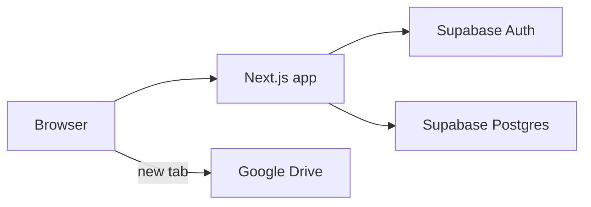
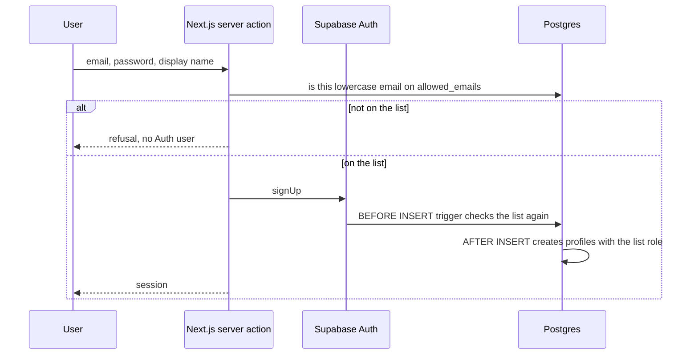
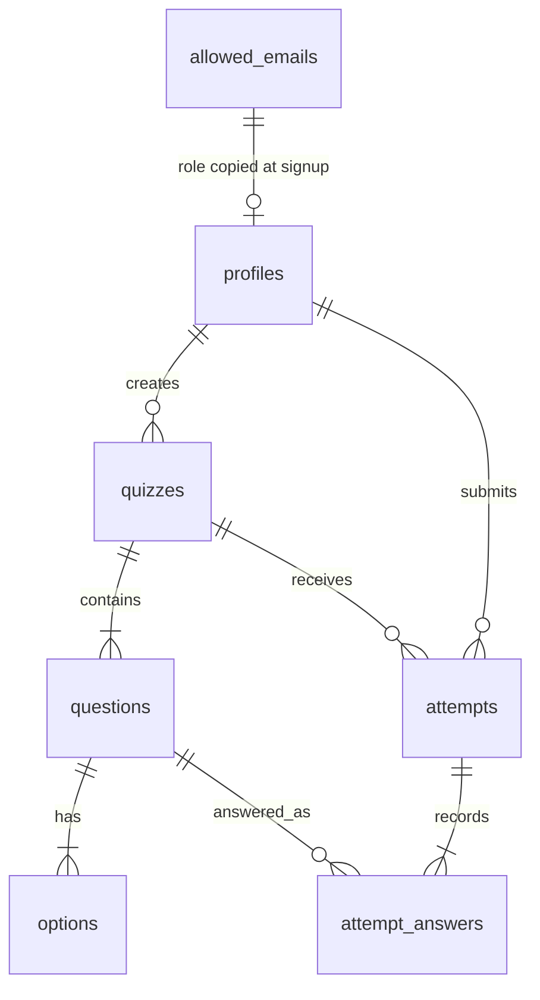

# Architecture: Financial Management and Strategy Quiz

Technical design for the app in [PRD.md](PRD.md). Build it in the order in [Task.md](Task.md). Visual rules live in [DESIGN_SYSTEM.md](DESIGN_SYSTEM.md).

## System context

One Next.js app talks to one Supabase project. Google Drive is only a link target. This app does not upload files and does not call the Drive API.



| Piece | Responsibility |
| --- | --- |
| Next.js App Router | Pages, server actions, session checks, grading request |
| Supabase Auth | Email and password accounts, session cookies |
| Supabase Postgres | Roster, quizzes, attempts, materials, Row Level Security |
| Google Drive | Hosts the files. The app stores the URL only |

The anon key is public and ships to the browser. The service-role key stays in server-only environment variables and is used only to seed the first admin email. Request handlers for sign-up, quizzes, and grading use the signed-in user's JWT.

## Application structure

```text
app/
  login/                         email and password sign-in
  signup/                        email, password, display name
  quizzes/                       published quiz list
  quizzes/[quizId]/              take a quiz
  quizzes/[quizId]/attempts/[attemptId]/   result review
  quizzes/[quizId]/leaderboard/  per-quiz board
  materials/                     Drive link list
  admin/roster/                  allowlist add and remove
  admin/quizzes/                 quiz list for the admin
  admin/quizzes/[quizId]/        question and option editor
  admin/materials/               material editor
lib/supabase/                    browser client and server client
supabase/migrations/             schema, triggers, RLS, submit_attempt
```

Shared navigation shows Quizzes, Materials, and Log out. Each quiz page links to that quiz's leaderboard. Admins also see Roster and Quiz builder. Sign up is linked from the login page.

Admin routes check `profiles.role = 'admin'` on the server. A student request is redirected to the quiz list.

## Authentication

Accounts exist only for emails on `allowed_emails`. The person chooses the password at sign-up. The role is copied from the allowlist row.



Two checks are required:

1. The sign-up server action looks up the lowercased email and returns a short error when it is missing. This is the message the person sees.
2. A `BEFORE INSERT` trigger on `auth.users` raises if that email is not on `allowed_emails`. A direct client call to `signUp` cannot skip this.

An `AFTER INSERT` trigger on `auth.users` inserts `profiles` with `display_name` from user metadata and `role` from the matching allowlist row.

Login calls `signInWithPassword`, then checks the email is still on `allowed_emails`. If it was removed, the server signs the session out and shows the same refusal. Existing attempt rows stay in the database.

The first admin is a SQL seed that inserts one email into `allowed_emails` with role `admin`. That person signs up through the app. The roster page adds and removes emails and sets role. It never sets a password.

Comparison is case-insensitive. Emails are stored lowercase.

## Quiz taking and grading

The browser sends the quiz id and the selected option ids. It does not send a score. Grading runs in the Postgres function `submit_attempt`, called with the student's JWT.

For each question:

- Load the correct option ids on the server.
- A question scores 1 only when the selected set equals the correct set.
- An unanswered question scores 0.
- A `single` question has exactly one correct option. A `multi` question has one or more. The quiz builder rejects anything else before publish.

Attempt score is `round(correct_count / question_count * 100)` as a whole number.

`submit_attempt` inserts one `attempts` row and one `attempt_answers` row per question. Each answer row stores `selected_option_ids` and a snapshot of `correct_option_ids` from that moment. Later edits to the question do not change a stored review.

Students can submit again immediately. Each submit is a new attempt.

## Leaderboard

One board per quiz. It is a read-only view, `quiz_leaderboard`, selectable by any signed-in user.

For each student with at least one attempt on that quiz, the counting attempt is:

1. The highest `score`.
2. If several attempts share that score, the earliest `submitted_at`.

Rows sort by score descending, then `submitted_at` ascending, then display name A to Z. The page shows rank, display name, score, and that submit time. A later attempt with a lower score does not replace the row.

Students who never submitted that quiz are omitted.

## Materials

`materials` stores `title`, `url`, and `position`. The admin form accepts only `http` and `https` URLs. The student list renders each title as a link with `target="_blank"` and `rel="noopener noreferrer"`. Sharing the Drive file is done in Google Drive, outside this app.

## Data model



| Table | Notes |
| --- | --- |
| `allowed_emails` | `email` unique, lowercase. `role` is `admin` or `student` |
| `profiles` | `id` equals `auth.users.id`. `display_name`, `role` |
| `quizzes` | `title`, `description`, `status` (`draft`, `published`, `archived`), `created_by` |
| `questions` | `quiz_id`, `prompt`, `type` (`single` or `multi`), `position` |
| `options` | `question_id`, `label`, `is_correct`, `position` |
| `attempts` | `quiz_id`, `student_id`, `score`, `submitted_at` |
| `attempt_answers` | `attempt_id`, `question_id`, `selected_option_ids`, `correct_option_ids` |
| `materials` | `title`, `url`, `position` |

`attempt_answers.question_id` stays valid after a quiz is archived. Deleting a question that already has answers is blocked, or the answer row keeps the prompt text copied onto the answer at submit time. Prefer a `prompt_snapshot` column on `attempt_answers` so the result page still renders if the question row is removed.

## Row Level Security

RLS is enabled on every public table.

| Actor | Can do |
| --- | --- |
| Anonymous | No table access. Sign-up reaches Auth only after the trigger allows the email |
| Student | Read published quizzes, their questions, and options. Read materials. Read `quiz_leaderboard`. Insert and read only their own attempts through `submit_attempt`. No writes to `allowed_emails`, quizzes, or materials |
| Admin | Insert, update, and delete `allowed_emails`, quizzes, questions, options, and materials. Read all attempts |

`attempts.score` has no student update policy. The only insert path is `submit_attempt`, which is `security definer` and writes the computed score.

Draft and archived quizzes are excluded from student select policies. Admins can select every status.

## Environment

| Variable | Where it is used |
| --- | --- |
| `NEXT_PUBLIC_SUPABASE_URL` | Browser and server |
| `NEXT_PUBLIC_SUPABASE_ANON_KEY` | Browser and server |
| `SUPABASE_SERVICE_ROLE_KEY` | Seed script only. Never imported by a client component |

The app refuses to boot the public pages when the URL or anon key is missing.

## Trust boundaries

- The browser is untrusted for scores, roles, and allowlist membership.
- Published option rows include `is_correct` because this is practice. Forged client scores still fail because `submit_attempt` recomputes them.
- Drive URLs are ordinary links. The app does not proxy the file and does not grant Drive access.
