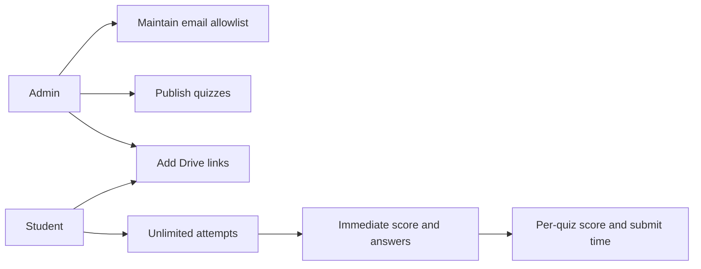

# Product Requirements: Financial Management and Strategy Quiz

## Purpose

A single-class web app for **Financial Management and Strategy**. Students on the class email list sign up and log in with Supabase Auth, practice with unlimited quiz attempts, and open course materials stored on Google Drive. Admins keep that email list, publish quizzes, and maintain the material list.

This is a practice tool, not a proctored exam system.

## Users

| Role | Who | What they need |
| --- | --- | --- |
| Admin | Course instructor | Keep the class email list, build quizzes, add Drive links, see who is practicing |
| Student | Classmate whose email is on the list | Sign up, log in, take quizzes, see the score and correct answers right away, open materials, check the per-quiz leaderboard |

Only emails on the class list can sign up or log in. Anyone else is rejected. People on the list choose their own password. The admin does not create passwords for them.

## Success criteria

- An email on the class list can sign up and log in. An email that is not on the list cannot.
- An admin can publish a quiz that mixes single-answer and multi-select questions.
- A student can retake a published quiz as many times as they want.
- After submit, the student immediately sees the score and which answers were correct.
- Each quiz has its own leaderboard. A student is ranked by best score, and an earlier submit time ranks above a later one when the score is the same.
- A student can open a course material link in a new browser tab.

## Scope

### In scope

- Supabase Auth sign-up and login with email and password, limited to the class email list.
- Two roles: `admin` and `student`.
- Quiz builder with two question types.
- Unlimited practice attempts and stored attempt history.
- Immediate auto-grading and answer review.
- One leaderboard per quiz, ranked by score and submit time.
- A materials list of titles plus Google Drive URLs.

### Out of scope

- Essays, short answers, or manual grading.
- Timers, attempt limits, or lockdown browsers.
- File upload or file hosting. Materials are links only.
- Open registration for emails that are not on the class list.
- Password-reset email design beyond Supabase defaults, and payments.
- An overall leaderboard across quizzes.
- Multiple courses, classes, or tenants.
- Notifications, analytics dashboards, and mobile apps.

## Stack

- **Frontend:** Next.js (App Router) and TypeScript.
- **Backend:** Supabase Auth and Postgres on the free project tier.
- **Account creation:** Supabase Auth `signUp` and `signInWithPassword`. The anon key is public. The service-role key, if used for seeding, stays on the server and is never sent to the browser.
- **UI:** follow [DESIGN_SYSTEM.md](DESIGN_SYSTEM.md): Courier New, sharp corners, thick borders, and the documented black, white, red, blue, and yellow palette.

## Roles and permissions

| Action | Admin | Student |
| --- | --- | --- |
| Sign up, log in, and log out when their email is on the list | Yes | Yes |
| Add or remove emails on the class list | Yes | No |
| Create, edit, publish, or archive quizzes | Yes | No |
| Take a published quiz | No | Yes |
| View own attempt history and results | Yes, for any student | Own attempts only |
| View leaderboard | Yes | Yes |
| Create, edit, or delete material links | Yes | No |
| Open material links | Yes | Yes |

Draft quizzes are visible to admins only. Students see published quizzes only.

## Flows

### Admin sets who may sign in

1. Admin adds an email to the class list and sets its role to `student` or `admin`.
2. That person opens sign up, enters the same email, a password, and a display name.
3. Supabase Auth creates the account only because the email is on the list. A `profiles` row is created with the role from the list.
4. Later visits use log in with that email and password.
5. Removing an email blocks new sign-up and later log in for that address. Attempts already stored stay on the quiz for history.

### Admin builds a quiz

1. Admin creates a quiz with a title and optional short description.
2. Admin adds questions. Each question is either single-answer or multi-select.
3. Each question has two or more options. At least one option is marked correct. A single-answer question has exactly one correct option. A multi-select question has one or more.
4. Admin publishes the quiz. Students can take it. Archiving hides it from students without deleting past attempts.

### Student takes a quiz

1. Student opens a published quiz and starts an attempt.
2. Student answers every question. Unanswered questions count as wrong.
3. Student submits once for that attempt.
4. The results screen shows the total score, each question, the student's selections, and the correct options.
5. Student may start another attempt at any time.

### Student opens a material

1. Student opens the materials list.
2. Each row shows a title and opens its Google Drive URL in a new tab.

### Leaderboard

1. Either role opens a quiz and its leaderboard. There is no combined board across quizzes.
2. The board lists one row per student who has submitted that quiz.
3. The row uses that student's best score. The time shown is the `submitted_at` of the attempt that earned that score. If two attempts share the best score, the earlier submit time is the one that counts.
4. Rank is higher score first. When scores are equal, the earlier submit time ranks higher. When both match, display name A to Z decides the order.

## Functional requirements

### Authentication

- Sign-up and login use Supabase Auth with email and password.
- The class roster is an email allowlist. Comparison is case-insensitive.
- Sign-up sends email, password, and display name. It succeeds only when that email is already on the list. The account role comes from the list, not from the form.
- An email that is not on the list cannot sign up and cannot log in. The app shows a short refusal and does not create an Auth user.
- The allowlist check runs in the server path before `signUp`, and again in the database or an Auth hook so a direct client call cannot skip it.
- Login uses `signInWithPassword`. A session stays signed in across normal browser restarts until logout. Each login also checks that the email is still on the list.
- Routes for the email list, quiz building, and material editing require the `admin` role.
- The first admin email is placed on the allowlist outside the in-app form so someone can sign up and manage the rest of the list.

### Quizzes

- A quiz has a title, optional description, status (`draft`, `published`, `archived`), and an ordered list of questions.
- Question types:
  - **Single-answer:** one correct option. The student selects one option.
  - **Multi-select:** one or more correct options. The student selects every option they believe is correct.
- Scoring is all-or-nothing per question. A multi-select question scores only when the selected set matches the correct set exactly. Partial credit is not awarded.
- Score for an attempt is `(correct questions / total questions) * 100`, shown as a whole-number percentage.
- Option and question order is the order the admin set. The app does not shuffle.

### Attempts

- Each submit creates one attempt tied to the student and the quiz, plus one answer row per question.
- Grading happens on submit. The student does not wait for an admin.
- Attempt history lists date, score, and a link back to that result review.
- Archived or deleted-from-the-builder content must not erase stored attempts. Questions and options used by an attempt stay readable on the result screen.

### Leaderboard

- There is one board per quiz. Students with no submitted attempt on that quiz are omitted. They are not listed as zero.
- One row per student. The counting attempt is the highest score. If several attempts share that score, the earliest `submitted_at` is the counting attempt.
- Sort by score descending, then by that attempt's `submitted_at` ascending, then by display name A to Z.
- Each row shows rank, display name, score, and the submit time of the counting attempt.
- A new attempt replaces the row only when its score is higher, or when the score is equal and `submitted_at` is earlier. A later, lower score does not change the row.

### Materials

- A material has a title, a Google Drive URL, and optional display order.
- The URL must be an `http` or `https` link. The admin is responsible for making the Drive file shareable.
- The student-facing control uses a new tab (`target="_blank"` with `rel="noopener noreferrer"`).
- Empty list shows a short empty state, not an error.

## Data outline

All tables live in Supabase Postgres. `profiles.id` matches the Auth user id.

| Table | Purpose | Key fields |
| --- | --- | --- |
| `allowed_emails` | Class roster gate for Supabase Auth | `email` (unique, stored lowercase), `role` (`admin` or `student`) |
| `profiles` | Role and display name for a signed-up user | `id`, `display_name`, `role` (`admin` or `student`) |
| `quizzes` | Quiz header | `id`, `title`, `description`, `status`, `created_by` |
| `questions` | Questions on a quiz | `id`, `quiz_id`, `prompt`, `type` (`single` or `multi`), `position` |
| `options` | Answer choices | `id`, `question_id`, `label`, `is_correct`, `position` |
| `attempts` | One submitted try | `id`, `quiz_id`, `student_id`, `score`, `submitted_at` |
| `attempt_answers` | Selections for that try | `id`, `attempt_id`, `question_id`, `selected_option_ids` |
| `materials` | Drive links | `id`, `title`, `url`, `position` |

`selected_option_ids` stores the options the student chose so a later edit to the question does not rewrite history. The result screen compares that stored set with the options' `is_correct` flags captured at submit time. Store a snapshot of correctness on the answer row (`correct_option_ids` or equivalent) so later edits do not change old reviews.

## Non-functional requirements

- **Row Level Security** is on for every table. Students can read published quizzes, questions, and options, read materials, read the per-quiz leaderboard, and read or insert only their own attempts. Admins can manage the email list, quizzes, questions, options, materials, and profiles. Students cannot insert or edit `allowed_emails`.
- Correct-answer flags are not required to stay hidden before submit because this is practice. They must still be graded on the server so a student cannot submit a forged score.
- The service-role key is never shipped to the client. Sign-up uses the public anon key only after the allowlist check.
- Pages use the layout rules in the design system: max width 1280px, 8px spacing rhythm, no rounded corners, and no horizontal overflow below 768px.
- Empty states use a short sentence and, for admins, the action that fills the list.

## Acceptance examples

- A single-answer question with the correct option selected scores 1. Any other selection scores 0.
- A multi-select question with correct options A and C scores 1 only when the student selects A and C and nothing else.
- An email that is not on the list cannot complete sign-up.
- Student scores 40, then 80, then 60 on the same quiz. That quiz's leaderboard shows 80 and the submit time of the 80 attempt.
- Two students both have a best score of 80 on that quiz. The one who submitted that 80 earlier ranks higher, and both submit times are visible.
- A Drive link click leaves the app and opens the URL in a new tab.
